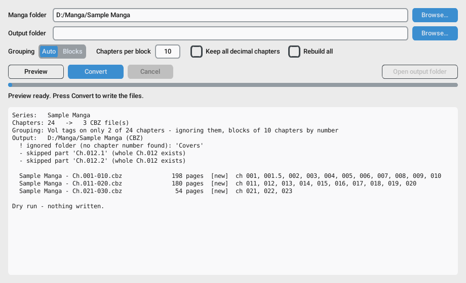

# Manga2CBZ

Turn folders of manga chapter images into `.cbz` comic archives, in the right order, with one click.



Point it at a series folder like this:

```
Sample Manga/
├── Vol.01 Ch.001 - The Beginning/   1.jpg 2.jpg … 18.jpg
├── Ch.001.5/                        1.webp 2.webp …
├── Ch.002/
└── …
```

and it produces:

```
Sample Manga (CBZ)/
├── Sample Manga - Ch.001-010.cbz
├── Sample Manga - Ch.011-020.cbz
└── Sample Manga - Ch.021-030.cbz
```

Your original image folders are never modified.

## Features

- **Understands common chapter folder names**, even mixed within one series:
  `Ch.001`, `Vol.01 Ch.001 - Title`, `Chapter 12`, `[Group] Vol.3 Ch.25`, `Ch.010.5`.
  Everything is ordered by chapter number, whatever the naming style.
- **Correct page order**: `10.jpg` comes after `9.jpg`, not after `1.jpg`.
- **Sensible grouping**: one CBZ per real volume when every chapter has a volume tag,
  otherwise blocks of 10 chapters (`Ch.001-010`, `Ch.011-020`, …). Block size is adjustable.
- **Decimal chapters handled**
  - `Ch.004.1`, `Ch.004.2` are treated as parts of chapter 4. They're skipped if a whole
    `Ch.004` exists and used in order if it doesn't.
  - `Ch.004.5` is treated as a side story and is always included, right after chapter 4.
- **JPG, PNG, WebP, GIF and AVIF**, mixed freely in the same folder. Files with the wrong
  extension (for example a WebP saved as `.jpg`) are detected and named correctly inside the
  CBZ, so readers like CDisplayEx display every page.
- **Safe re-runs**: unchanged CBZ files are skipped. When new chapters arrive, only the
  affected block is rebuilt.
- **Preview first**: see exactly which files will be created, and any warnings (empty
  folders, duplicate pages, skipped parts), before anything is written.
- **ComicInfo.xml metadata** (series, volume, title, page count, right-to-left manga flag)
  for Komga, Kavita, Calibre and similar apps.
- **Cancel at any time**: finished files are kept and half-written files are removed.

## Download (Windows)

Grab `Manga2CBZ.exe` from the [Releases](../../releases) page. It's a single file with
nothing to install.

> Windows SmartScreen may warn about an unrecognised app the first time.
> Click **More info → Run anyway**.

## Using the app

1. **Browse…** to a series folder (the one that *contains* the chapter folders).
   A preview appears straight away.
2. Check the plan in the log, then press **Convert**.
3. **Open output folder** when it's done.

| Option | What it does |
|---|---|
| Output folder | Where CBZ files go. Leave it empty for `<series> (CBZ)` next to the series folder. |
| Grouping: Auto | Real volumes if every chapter is tagged, otherwise blocks. |
| Grouping: Blocks | Always blocks of *N* chapters, ignoring volume tags. |
| Chapters per block | Size of each block (default 10). |
| Keep all decimal chapters | Include `Ch.N.1`, `Ch.N.2` … even when a whole `Ch.N` exists. |
| Rebuild all | Rewrite every CBZ, even ones that are up to date. |

## Command line

The converter also works on its own and needs only Python 3.9+ (no extra packages):

```bash
python manga2cbz.py "D:/Manga/Some Title" --dry-run     # preview only
python manga2cbz.py "D:/Manga/Some Title"               # convert
python manga2cbz.py "D:/Manga/Some Title" --mode chunk --size 20 -o "D:/CBZ"
```

| Flag | Meaning |
|---|---|
| `-o, --out DIR` | Output folder |
| `--mode auto\|chunk` | Grouping, as above |
| `--size N` | Chapters per block |
| `--keep-all-decimals` | Don't skip decimal parts |
| `--overwrite` | Rebuild every CBZ |
| `--dry-run` | Show the plan, write nothing |

## Running from source

```bash
pip install -r requirements.txt
python manga2cbz_gui.py
```

### Building the exe yourself

On Windows, double-click `build_exe.bat`. It creates a private build environment, installs
PyInstaller and CustomTkinter, and writes `dist/Manga2CBZ.exe`.


### Tests

```bash
pip install pytest
python -m pytest
```

## How the CBZ is built

A CBZ is a ZIP archive of images. Pages are stored uncompressed (images are already
compressed) and renamed `001_001.jpg`, `001_002.jpg`, … (chapter position, page) so every
reader shows them in the right order. A `ComicInfo.xml` file records which chapters each
CBZ contains, which is how re-runs know whether a file is up to date.

## License

[MIT](LICENSE)
